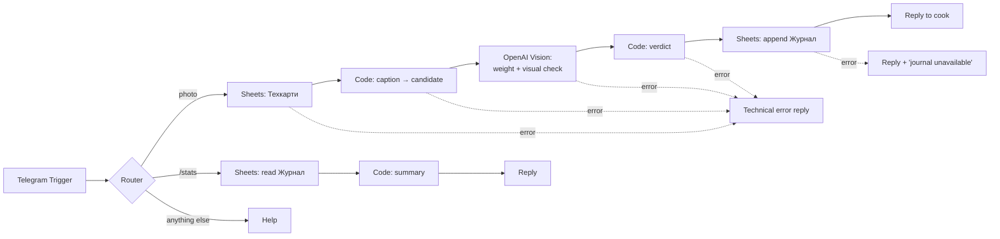

# Sushi QC Bot — dish weight control from a photo

A Telegram bot built on **n8n** that checks every portion against its recipe card. The cook takes one photo of the dish on the kitchen scale and adds the dish name or code as a caption. The bot then:

1. reads the weight off the scale display with **OpenAI Vision**,
2. finds the recipe card and compares the weight with the norm ± tolerance,
3. checks that the photo actually **looks like the dish named in the caption**, such as eel on top rather than salmon,
4. writes a row to a **Google Sheets** journal and replies to the cook in seconds.

It replaces manual spot checks with a full log of every portion. The cook does one extra thing: sends a photo.

> The recipe cards in `data/techcards.csv` belong to **Nori Lab**, a fictional sushi bar made up for this demo (30 items). The bot's replies are in Ukrainian.

## How it works



There is one Vision call per photo. When the caption names a dish, the prompt carries that dish's `visual_features`, so a single call returns the weight, a short description and a `visual_match` flag.

## Verdicts

| Verdict | When | Reply |
|---|---|---|
| `OK` | weight within norm ± tolerance | ✅ У нормі |
| `BRAK` | weight outside tolerance | ⛔️ БРАК — поза допуском |
| `MISMATCH` | the photo clearly isn't the dish in the caption | 🚫 Фото не схоже на «…» + reason |
| `LOWCONF` | the dish can't be identified (no or unknown caption, several dishes weigh the same) | ⚠️ up to 3 candidates + "add the name or code" |
| `UNREADABLE` | the display digits aren't visible, or Vision returned nothing | ❓ retake the photo |

Commands: `/stats` (today), `/stats all` (all time), `/help`.

## What the cook can write in the caption

| Caption | How it's matched |
|---|---|
| `R02`, `р2`, `R-2` | dish code (Latin or Cyrillic *р*) |
| `Філадельфія з вугрем`, `філа вугор` | full name or any alias from `aliases` |
| `запечений з креветкою 8шт` | word match against names and aliases. If several dishes tie, the weight picks the one within tolerance |
| `Тех карта 350 г` | a bare norm with the default tolerance (no dish card) |
| *(nothing)* | weight only: if exactly one dish of the type seen on the photo (roll / poke / nigiri / gunkan) fits the tolerance, it is used; otherwise candidates are listed |

The decision code also covers a known scale/Vision quirk: a reading of `3008` for a 300 g card is treated as `300.8`, because the decimal point was lost.

## Data model — one Google Sheet, two tabs

**`Техкарти`** (recipe cards, the source of truth): `dish_id, dish_name, aliases, category, pieces, norm_grams, tolerance_pct, composition, visual_features, active`.
`visual_features` is what a person sees on the plate, such as *"зверху темно-коричневий вугор; соус унагі; кунжут"*. The bot compares the photo against it. `active = FALSE` hides a dish without deleting it.

**`Журнал`** (one row per check): `ts, date, chef, chat_id, dish_id, dish_name, match_source (caption|norm|weight), norm_grams, actual_grams, deviation_pct, tolerance_pct, verdict, visual_check, visual_reason, tg_message_id`.

The sheet doubles as the admin panel. The kitchen manager edits norms and tolerances in the sheet, with no code changes.

## Repository

```
workflows/sushi-qc-bot.json   n8n workflow (credentials and spreadsheet ID are placeholders)
data/techcards.csv            demo recipe cards — 30 dishes, composition sums to the norm
data/journal_template.csv     journal header row
tests/run-scenarios.js        offline tests of the decision logic (no n8n or API keys needed)
docs/setup.md                 step-by-step installation
```

## Setup

The short version: create a Telegram bot, an OpenAI key and a Google service account. Import the two CSVs as tabs `Техкарти` and `Журнал`. Import the workflow, then set the three credentials and the spreadsheet ID and activate it. Full steps are in **[docs/setup.md](docs/setup.md)**.

## Tests

```bash
node tests/run-scenarios.js
```

The tests run the workflow's own Code nodes, taken straight from the JSON, against the recipe cards, with Telegram and Vision replaced by fixtures. They cover 16 decision scenarios plus `/stats`: norm and code captions, aliases, an ambiguous caption, a caption that doesn't match the photo, weight-only matching with "twins", an unknown dish, a lost decimal point, an unreadable display and an empty Vision answer.

## Limits

- **Twins can't be told apart from the photo alone.** Two dishes that look the same and weigh the same, but differ only inside (fresh vs. lightly salted salmon, tempura with salmon vs. eel), need a caption. The demo menu includes such pairs on purpose.
- **Photo time.** Telegram strips EXIF from compressed photos, so the journal records the time the photo was sent. Sending the photo as a file keeps the original.
- **Hosting.** The demo runs on a local n8n behind a tunnel. A real kitchen needs a permanent host (n8n Cloud or a small VPS).
- **Cost.** About one gpt-4o vision call per photo, a fraction of a cent. At ~30 portions a day per venue this is negligible.

## Possible next steps

- Inline buttons with the 2–3 candidates, so an ambiguous photo is resolved with one tap.
- Reference-photo matching (embeddings of menu photos) to identify dishes without a caption.
- Scheduled daily reports of out-of-tolerance portions to a manager's chat.
- A dashboard on top of the journal: % in norm, worst dishes, by cook or shift.

## License

MIT — see [LICENSE](LICENSE).
