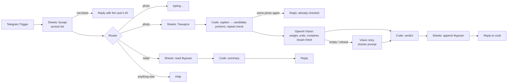

# Sushi QC Bot — dish weight control from a photo

A Telegram bot built on **n8n** that checks every portion against its recipe card. The cook zeroes the scale, takes one photo of the dish on it and adds the dish name or code as a caption. The bot then:

1. reads the weight off the scale display with **OpenAI Vision**, including the units, and handles a container and several portions,
2. finds the recipe card and compares the weight with the norm ± tolerance,
3. checks that the photo actually **looks like the dish named in the caption**, such as eel on top rather than salmon. Garnish that isn't in the card doesn't count against the dish,
4. writes a row to a **Google Sheets** journal and replies to the cook in seconds.

It replaces manual spot checks with a full log of every portion. The cook does one extra thing: sends a photo.

> The recipe cards in `data/techcards.csv` belong to **Nori Lab**, a fictional sushi bar made up for this demo (30 items). The bot's replies are in Ukrainian; captions may be Ukrainian or Russian.

## How it works



There is one Vision call per photo, and a second one only if the first returns no JSON. When the caption names a dish, the prompt carries the card's `must_have` features (what must be visible) and `may_vary` (garnish, sauce, packaging — never a reason to reject).

## Verdicts

| Verdict | When | Reply |
|---|---|---|
| `OK` | weight within norm ± tolerance | ✅ У нормі |
| `BRAK` | weight outside tolerance | ⛔️ БРАК — поза допуском |
| `MISMATCH` | the photo clearly isn't the dish in the caption (Vision confidence ≥ 0.7) | 🚫 Фото не схоже на «…» + reason |
| `RECHECK` | the digits are unclear, or the deviation is over 30% — more likely a misread, a container or several portions than a real portion | 🔎 Перевірте фото + what to do |
| `LOWCONF` | the dish can't be identified (no or unknown caption, several dishes weigh the same) | ⚠️ up to 3 candidates + "add the name or code" |
| `UNREADABLE` | no digits on the photo, or Vision returned nothing twice | ❓ retake the photo |

A visual doubt below the confidence threshold doesn't override the weight verdict; the reply gets a "⚠️ можлива невідповідність" line instead.

Commands: `/stats` (today), `/stats all` (all time), `/help`.

## What the cook can write in the caption

| Caption | How it's matched |
|---|---|
| `R02`, `р2`, `R-2` | dish code (Latin or Cyrillic *р*) |
| `Філадельфія з вугрем`, `філа вугор`, `Филадельфия угорь` | full name or an alias. Ukrainian and Russian spellings fold together (і/и/ы, є/э, ь) |
| `запечений з креветкою 8шт` | word match against names and aliases. If several dishes tie (`Дракон`, `Темпура`), the weight picks the one within tolerance, otherwise the bot lists the candidates |
| `R06 х2`, `2 порції Каліфорнія з крабом` | several portions: the norm is multiplied |
| `Тех карта 350 г` | a bare norm with the default tolerance (no dish card) |
| *(nothing)* | weight only: if exactly one dish of the type seen on the photo (roll / poke / nigiri / gunkan) fits the tolerance, it is used; otherwise candidates are listed |

The weight logic also handles:
- a kilogram display (`0.410`),
- a lost decimal point (`3008` for a 300 g card is read as `300.8`),
- a container. Its weight (`pack_grams`) is subtracted only when Vision sees one **and** that brings the reading closer to the norm. The reply shows the subtraction.

The same photo sent twice is rejected, using the Telegram `file_unique_id` kept in workflow static data.

## Data model — one Google Sheet, three tabs

**`Техкарти`** (recipe cards, the source of truth): `dish_id, dish_name, aliases, category, pieces, norm_grams, tolerance_pct, pack_grams, composition, must_have, may_vary, active`.
- `must_have` is what identifies the dish on the plate, such as *"зверху темно-коричневий вугор"*.
- `may_vary` is what may or may not be there, such as *"соус унагі; кунжут; ікра"*.
- `active = FALSE` hides a dish without deleting it.

**`Журнал`** (one row per check): `ts, date, chef, chat_id, dish_id, dish_name, match_source, portions, norm_grams, scale_grams, tare_grams, net_grams, deviation_pct, tolerance_pct, verdict, visual_check, visual_reason, digits_confidence, photo_uid, tg_message_id`.

**`Кухарі`** (who may use the bot): `chat_id, name, venue, active`. An unknown user gets a reply with their Telegram ID to pass to the admin.

The sheet doubles as the admin panel. The kitchen manager edits norms, tolerances and the cook list in the sheet, with no code changes.

## Repository

```
src/                          Code node sources: match-caption.js, verdict.js, stats.js
tools/build-workflow.js       assembles workflows/sushi-qc-bot.json from src/ (node tools/build-workflow.js)
workflows/sushi-qc-bot.json   n8n workflow (credentials and spreadsheet ID are placeholders)
data/techcards.csv            demo recipe cards — 30 dishes, composition sums to the norm
data/journal_template.csv     journal header row
data/cooks_template.csv       access list template
tests/run-scenarios.js        offline tests of the decision logic (no n8n or API keys needed)
docs/setup.md                 step-by-step installation
docs/recognition-qa.ru.md     recognition QA: user questions, failure modes, fixes, before/after (in Russian)
```

## Setup

The short version: create a Telegram bot, an OpenAI key and a Google service account. Import the three CSVs as tabs `Техкарти`, `Журнал` and `Кухарі`. Import the workflow, then set the three credentials and the spreadsheet ID and activate it. Full steps are in **[docs/setup.md](docs/setup.md)**.

## Tests

```bash
node tests/run-scenarios.js
```

The tests run the Code node sources from `src/` against the recipe cards, with Telegram and Vision replaced by fixtures. There are 36 checks covering:
- captions: codes, aliases, Russian spelling, generic words,
- weight: units, portions, container, the tolerance edge (2.94% is outside 2.9%), a lost decimal point,
- what Vision said: unclear digits, implausible deviation, a confident and an unsure visual mismatch, an unreadable display, an empty answer,
- a repeated photo and `/stats`.

How the bot behaves on real photos and degraded copies of them is measured on a separate n8n eval stand. The results are in [docs/recognition-qa.ru.md](docs/recognition-qa.ru.md).

## Limits

- **Twins can't be told apart from the photo alone.** Two dishes that look the same and weigh the same, but differ only inside (fresh vs. lightly salted salmon, tempura with salmon vs. eel), need a caption. The demo menu includes such pairs on purpose.
- **Vision can misread blurry digits with full confidence.** The model's self-reported `digits_confidence` is not reliable. Deviations over 30% become `RECHECK` instead of `BRAK`, but a misread that lands within 30% can still produce a wrong `BRAK`. A second, zoomed-in reading of the display is the planned fix.
- **Near-identical dishes** with similar coatings are not always caught as a mismatch. Reference photos per dish are the planned fix.
- **Google Sheets read quota.** Every message reads the cook list and every photo reads the recipe cards. Bursts of several photos a minute can hit the quota; caching the cards is the planned fix.
- **Photo time.** Telegram strips EXIF from compressed photos, so the journal records the time the photo was sent. Sending the photo as a file keeps the original.
- **Hosting.** The demo runs on a local n8n behind a tunnel. A real kitchen needs a permanent host (n8n Cloud or a small VPS).
- **Cost.** About one gpt-4o vision call per photo, a fraction of a cent. At ~30 portions a day per venue this is negligible.

## Possible next steps

- Inline buttons with the 2–3 candidates, so an ambiguous photo is resolved with one tap.
- Reply to the bot's message with a code to re-check the same photo; album support.
- Reference photos per dish and a second display reading, for near-identical dishes and blurry digits.
- Scheduled daily reports and a dashboard on top of the journal: % in norm, worst dishes, by cook or shift.

## License

MIT — see [LICENSE](LICENSE).
