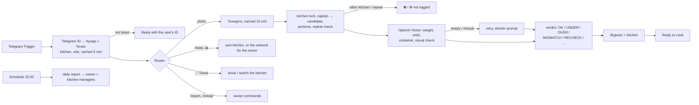

# Sushi QC Bot — portion weight control for a network of sushi kitchens

A Telegram bot built on **n8n** for a chain of delivery-only sushi kitchens that all cook by **one shared set of recipe cards**. A cook zeroes the scale, photographs the portion on it and captions it with the dish name or code. The bot:

1. reads the weight off the display with **OpenAI Vision** (units, container and several portions included),
2. compares it with the recipe card, with **separate tolerances for underweight and overweight**: the customer must not be short-changed (−2.9%), a little extra is tolerated (+5%),
3. checks that the photo **looks like the dish in the caption**,
4. writes a row to the shared **Google Sheets** journal, tagged with the cook's kitchen, and replies in seconds.

On top of the journal, each kitchen gets a page and the owner gets a network page that update themselves. On Telegram there are `/stats` reports and a daily summary at 22:00, so the owner sees **which kitchen under- or overfills, which dishes, which cooks**.

> Everything here is a demo: **Nori Lab** is a fictional network of four kitchens in Kyiv with made-up addresses, a 30-dish menu and two weeks of generated checks. The bot's replies are in Ukrainian; captions may be Ukrainian or Russian.

## What the owner sees

From the demo history (last 7 days, `/stats 7` in Telegram — the same numbers are on the «Мережа» page):

```
🏢 Мережа — за 7 днів
V1 Nori Lab Поділ: 201 перевірок        ✅ 92.5% · ⬇️ 3 (-3.2%) · ⬆️ 0 · 🚫 3 · 🔎 2
V2 Nori Lab Лівобережна: 189 перевірок  ✅ 58.2% · ⬇️ 62 (-4%) · ⬆️ 0 · 🚫 5 · 🔎 4
V3 Nori Lab Печерськ: 212 перевірок     ✅ 70.8% · ⬇️ 1 (-3.5%) · ⬆️ 44 (+6.4%) · 🚫 4 · 🔎 4
V4 Nori Lab Оболонь: 209 перевірок      ✅ 69.4% · ⬇️ 11 (-4.3%) · ⬆️ 2 (+5.2%) · 🚫 12 · 🔎 10
Найбільше недоваги: V2 Nori Lab Лівобережна (62 з 189, середня -4%)
Найбільше переваги: V3 Nori Lab Печерськ (44 з 212, середня +6.4%)
```

`/stats V2` then shows that kitchen's worst dishes (the Philadelphias and the Philadelphia set) and cooks.

## How it works



## Which kitchen a check goes to

The kitchen is never chosen by the cook in the moment. It comes from **who sends the photo**:

1. The bot takes the sender's **Telegram user ID** and finds it in `Кухарі`. Unknown IDs get «no access» and their ID to pass to the admin. A person added to the sheet is recognised from the next message.
2. The kitchen in that row must be an **active row of `Точки`**. Otherwise nothing is logged and the person is asked to contact the admin.
3. A cook **locked to one kitchen** always logs to it. If they write another kitchen's code in the caption («R25 V3»), the check is **not logged**: the bot explains why. This keeps the other kitchen's statistics clean and avoids a duplicate when the cook resends. The rejected photo isn't remembered, so it can be sent again without the code.
4. People who work in several kitchens get them in `allowed_venues` («V3;V4»). They can switch with the **«📍 Точка»** button, or send one check elsewhere with a code in the caption. The owner may use any kitchen. Their replies end with «📍 V4 · …», so it's always clear where a check went.

**Repeat photos.** Telegram gives every new camera shot its own file ID, so identical-looking portions never collide. Only the *same file* sent again is caught: with the same caption after a final verdict, it is not logged (♻️). With a new caption, or after an unfinished check (🔎, ❓), it is checked again (🔁).

The reply keyboard under the input field always has **«📍 Точка»** and **«📊 Статистика»**; `/help` adapts to the role.

## Verdicts

| Verdict | When | Reply |
|---|---|---|
| `OK` | weight within −`tol_under_pct` … +`tol_over_pct` of the norm | ✅ У нормі |
| `UNDER` | lighter than the norm allows | ⬇️ НЕДОВАГА — порція менша за норму |
| `OVER` | heavier than the norm allows | ⬆️ ПЕРЕВАГА — порція більша за норму |
| `MISMATCH` | the photo clearly isn't the dish in the caption (Vision confidence ≥ 0.7) | 🚫 Фото не схоже на «…» + reason |
| `RECHECK` | the digits are unclear, or the deviation is over 30% (more likely a misread, a container or several portions) | 🔎 Перевірте фото + what to do |
| `LOWCONF` | the dish can't be identified | ⚠️ up to 3 candidates |
| `UNREADABLE` | no digits on the photo, or Vision returned nothing twice | ❓ retake the photo |

## Roles and reports

| Role (`Кухарі.role`) | Sends photos | `/stats` | Also |
|---|---|---|---|
| `cook` | ✅ to their kitchen (and to `allowed_venues`, if set) | own kitchen | — |
| `manager` | ✅ the same | own kitchen | daily report for their kitchen at 22:00 |
| `owner` | ✅ to any kitchen | all kitchens side by side; `/stats V2` — one kitchen | `/report` (today's report now), `/reload` (re-read cards and cooks), daily network report at 22:00 |

Periods: `/stats` today, `/stats 7` last 7 days, `/stats all` all time. Someone who isn't on the list gets their Telegram ID to pass to the admin.

## Google Sheet

| Tab | What it holds |
|---|---|
| `Техкарти` | the shared recipe cards: `dish_id, dish_name, aliases, category, pieces, norm_grams, tol_under_pct, tol_over_pct, pack_grams, composition, must_have, may_vary, active` |
| `Точки` | `venue_id, name, address, city, active` |
| `Кухарі` | `chat_id` (the person's Telegram user ID)`, name, venue_id, venue, role, active, allowed_venues` (optional, «V3;V4») |
| `Журнал` | one row per check: `venue_id, venue, ts, date, chef, …, net_grams, deviation_pct, tol_under_pct, tol_over_pct, verdict, visual_check, …, demo` |
| `Мережа` | formulas: all kitchens for the last 7 days and today, the worst kitchen, the most underweight / overweight, top problem dishes. Cell B2 switches the demo rows on and off |
| `V1 · Поділ` … `V4 · Оболонь` | formulas: one kitchen's indicators (today / 7 days / all time), top dishes and cooks with deviations, all its checks newest first |

The pages are generated by `tools/sheet-pages.js`. They read the journal, so nothing has to be maintained by hand.

## Repository

```
src/                          Code node sources (cook, cooks-cache, point, match-caption, verdict, stats, report-now, daily, reset-cache, report-lib)
tools/build-workflow.js       assembles workflows/sushi-qc-bot.json from src/
tools/sheet-pages.js          formulas for «Мережа» and the kitchen pages; `node tools/sheet-pages.js ";"` writes them as CSV
tools/gen-demo-history.js     deterministic two-week demo journal → data/demo_journal.csv
workflows/sushi-qc-bot.json   n8n workflow (credentials and spreadsheet ID are placeholders)
data/                         techcards, venues, cooks and journal templates, demo journal, page CSVs
tests/run-scenarios.js        78 offline tests (no n8n or API keys needed)
docs/setup.md                 step-by-step installation
docs/recognition-qa.ru.md     recognition QA: user questions, failure modes, fixes, before/after (in Russian)
```

## Setup

Create a Telegram bot, an OpenAI key and a Google service account. Then:
1. Import the CSVs as tabs and the page CSVs as formula pages.
2. Import the workflow, set the three credentials and the spreadsheet ID, and activate it.
3. Add yourself to `Кухарі` as `owner`.

Full steps are in **[docs/setup.md](docs/setup.md)**.

## Tests

```bash
node tests/run-scenarios.js
```

The 78 checks run the Code node sources (and the built workflow) against the recipe cards, with Telegram and Vision replaced by fixtures:
- underweight and overweight at the edges of the asymmetric tolerance;
- captions: codes, aliases, Russian spelling, generic words;
- units, portions, container, misreads, the visual check, repeat photos and corrections;
- the kitchen lock: another kitchen's code, the own code, `allowed_venues`, the owner, unknown and inactive kitchens, lookup by Telegram ID;
- «📍 Точка» switching, caches, role-aware help, roles in `/stats` and `/report`;
- every Telegram message is sent as HTML with names and replies escaped;
- the daily report going to the right people;
- every one of the 1 495 weighed demo rows agrees with the verdict rule.

How the bot behaves on real photos is measured on a separate n8n eval stand: [docs/recognition-qa.ru.md](docs/recognition-qa.ru.md).

## Limits

- **Twins can't be told apart from the photo alone.** Dishes that look and weigh the same but differ inside need a caption.
- **Vision can misread blurry digits with full confidence.** Deviations over 30% become `RECHECK`, but a misread within 30% can still produce a wrong `UNDER`/`OVER`. A second, zoomed-in reading is the planned fix.
- **Google Sheets read quota.** The recipe cards and the cook list are cached (10 and 5 minutes), and every check writes one journal row. For several busy kitchens, a database instead of a sheet is the next step.
- **Hosting.** The demo runs on a local n8n behind a tunnel, so the 22:00 report only arrives while the computer is on. A real network needs a permanent host (n8n Cloud or a small VPS).
- **Photo time.** Telegram strips EXIF from compressed photos; the journal records the time the photo was sent.
- **The kitchen is trusted to the profile.** The bot can't see where a photo was physically taken. A cook working in two kitchens who forgets to switch logs to the last one chosen. The «📍 V…» line in every reply is the reminder.

## License

MIT — see [LICENSE](LICENSE).
